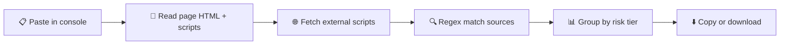

<div align="center">

# 🧲 DOM Source Scanner

**Find every place untrusted data enters client-side JavaScript, in one paste.**
A single-file, zero-install console script for bug bounty hunters and pentesters.


<br>

<!-- Replace with a screenshot of the tool -->


[How it works](#-how-it-works) · [Features](#-features) · [Usage](#-usage) · [Risk tiers](#-risk-tiers) · [Parameters](#-parameters) · [Limitations](#-limitations) · [Responsible use](#%EF%B8%8F-responsible-use)

</div>

---

## 💡 What is it?

DOM XSS starts with a **source**: a spot in the page where untrusted data — a URL fragment, a referrer, a `postMessage` payload — enters client-side JavaScript. Finding every one of those spots by hand means re-reading the same `location.hash`/`referrer`/`event.data` patterns across dozens of scripts. **DOM Source Scanner** does that scan for you.

Paste one script into the browser console and it statically scans the page's full HTML, every inline `<script>`, and every external script file for known sources, ranked by how exploitable they realistically are for XSS.

It only reads and matches text. It never executes, hooks or traces anything at runtime. It's a companion to a separate sink-scanning script, not included here — finding a source only means the data is read somewhere, it doesn't prove the value reaches a dangerous sink.

## ⚙️ How it works



## ✨ Features

| | |
|---|---|
| 🎯 **Risk-tiered results** | Sources are grouped by how exploitable they realistically are for XSS, not by generic category, so you know where to look first. |
| 🎚️ **Strict / full modes** | Strict keeps only the Critical and High tiers; full adds Medium and Low for a complete audit. |
| 🧩 **Tier filtering** | Scan every tier, one tier, or a chosen list — your call each time. |
| 🧹 **Deduplicated output** | The same match from the same source file is only reported once. |
| 📊 **Grouped console output** | Results print as collapsible, sortable tables per tier. |
| 📋 **One-command copy** | Pull the raw findings straight into your clipboard. |
| ⬇️ **JSON export** | Save a full scan as a timestamped JSON file. |
| 📦 **Zero dependencies** | Pure vanilla JavaScript. No install, no build step. |

---

## 🚀 Usage

1. Open the target page
2. Open DevTools (`F12`) and go to the **Console** tab
3. Paste the entire script and press **Enter** — nothing prints yet, it just defines the functions
4. Run a scan:

```javascript
sourceScan()                                  // strict mode: Critical + High only
sourceScan('full')                            // full mode: all four tiers
sourceScan('strict', 'Critical')              // strict mode, one tier
sourceScan('full', ['Critical', 'High'])      // full mode, a chosen list
```

5. Pull the results out:

```javascript
copy(window.__sourceFindings)         // copy to clipboard
downloadSourceFindings()              // save as JSON
downloadSourceFindings('scan.json')   // save with a custom name
```

> 💡 A match here only shows the data is read somewhere — it doesn't prove it reaches a dangerous sink. Treat findings as leads to triage by hand (or with a sink-scanning companion script), not confirmed bugs.

> 💡 Results reflect the page's DOM and scripts at the moment you scan. After an SPA navigation or a reload, run `sourceScan()` again.

---

## 🗂️ Risk tiers

### 🔴 Critical

Directly attacker-controlled via a crafted link — the single most common origin of DOM XSS.

| Source | Note |
|---|---|
| `location.hash` | The fragment after `#`, never sent to the server |
| `location.search` | The query string after `?` |
| `location.href` / `location` | The full current URL |
| `location.pathname` | The path portion of the URL |
| `document.URL` | Equivalent to `location.href` |
| `document.documentURI` | Equivalent, also works in XML documents |
| `URLSearchParams` | Structured access to query parameters |

### 🟠 High

Exploitable, but needs an intermediate step: tricking the victim into clicking a crafted link, or a cross-origin page setting the value before navigation.

| Source | Note |
|---|---|
| `document.referrer` | The URL of the page the visitor came from |
| `window.name` | Persists across navigations, even cross-origin |
| `event.data` (`postMessage`) | Data received from another frame or window |
| `addEventListener('message')` | Listener that receives cross-origin messages |

### 🟡 Medium

Only exploitable under extra conditions — the attacker already has some write access (a prior XSS, a vulnerable subdomain, a malicious extension), or server-side rendering reflects a URL parameter unescaped into embedded state.

| Source | Note |
|---|---|
| `localStorage.getItem` / `sessionStorage.getItem` | Previously stored browser data |
| `document.cookie` | Current cookie values |
| `window.__INITIAL_STATE__` / `__NEXT_DATA__` / `__NUXT__` | Server-injected state, sometimes built from a URL parameter |
| `history.state` | State attached to the current history entry |

### ⚪ Low

Not directly exploitable on their own — they need a separate injection path first.

| Source | Note |
|---|---|
| `navigator.userAgent` / `navigator.language` | Browser identification strings |
| `document.title` | The page title |
| `FileReader.result` | Contents of a file the user chose to read |
| `clipboardData.getData` / `navigator.clipboard.readText` | Clipboard contents |
| `indexedDB` | Structured data stored by the page |
| `caches` | Content stored by the Cache API |

---

## 🎛️ Parameters

| Parameter | Type | Default | Description |
|---|---|---|---|
| `mode` | `'strict' \| 'full'` | `'strict'` | `strict` scans only the Critical and High risk tiers — the ones that matter most for real-world XSS hunting; `full` adds Medium and Low for a complete audit. |
| `categories` | `string \| string[] \| null` | `null` (all tiers active for the chosen mode) | Pass a single tier name or an array of names to scan only those. |

---

## ⚠️ Limitations

- **Static, regex-based:** it reads source text, so it won't catch a source built dynamically, like `window['loc'+'ation']`.
- **CORS-blocked scripts are skipped:** external scripts without permissive CORS headers can't be fetched and read from the console.
- **Snapshot in time:** results reflect the DOM and scripts at scan time; re-run after any page change.
- **Source, not proof:** a match shows where untrusted data is read, not that it reaches a sink. Findings still need manual or sink-scanner-assisted triage.

---

## ⚖️ Responsible use

This tool is for authorized security research and bug bounty work. Only scan targets that are **in scope** for a program you're participating in, or that you have permission to test.

## 📄 License

Released under the [MIT License](LICENSE).

<div align="center">
<sub>Built for hunters who trace data before they trust it. 🧲</sub>
</div>
